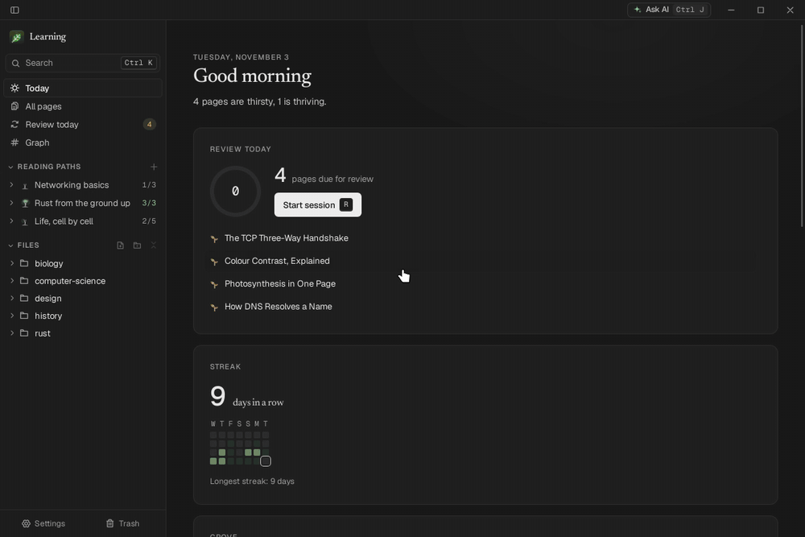
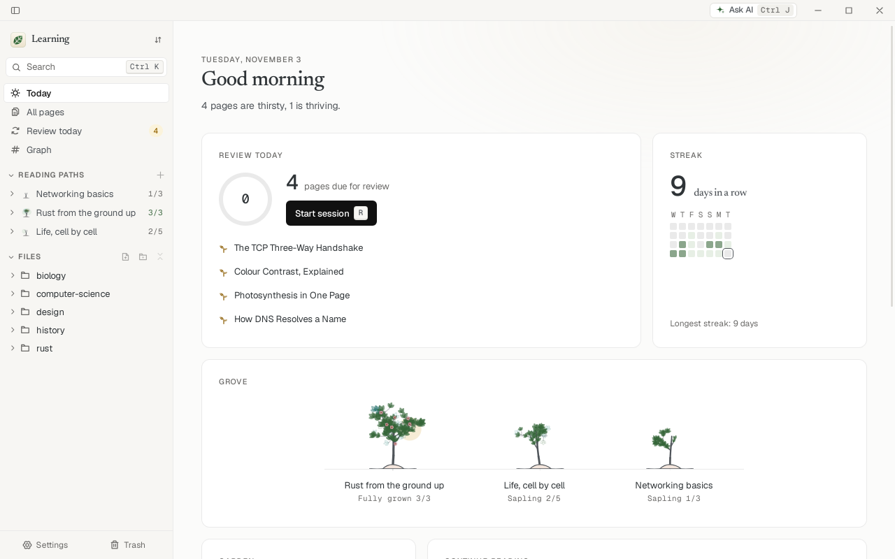
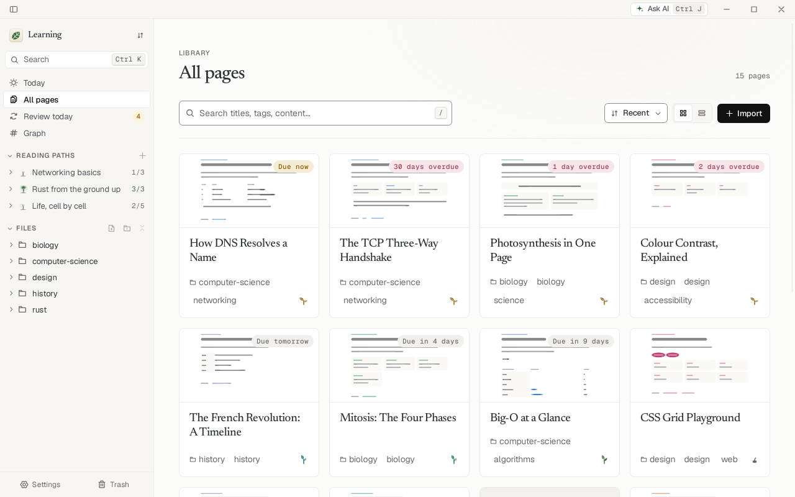
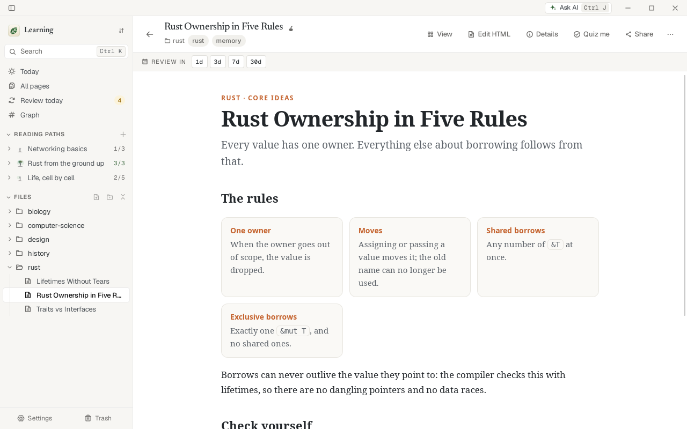
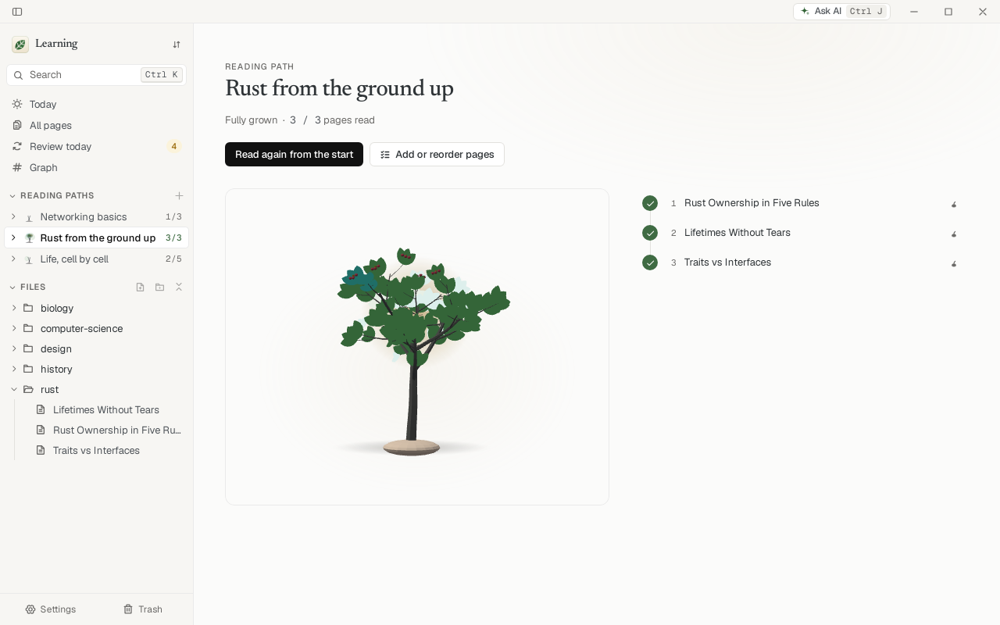
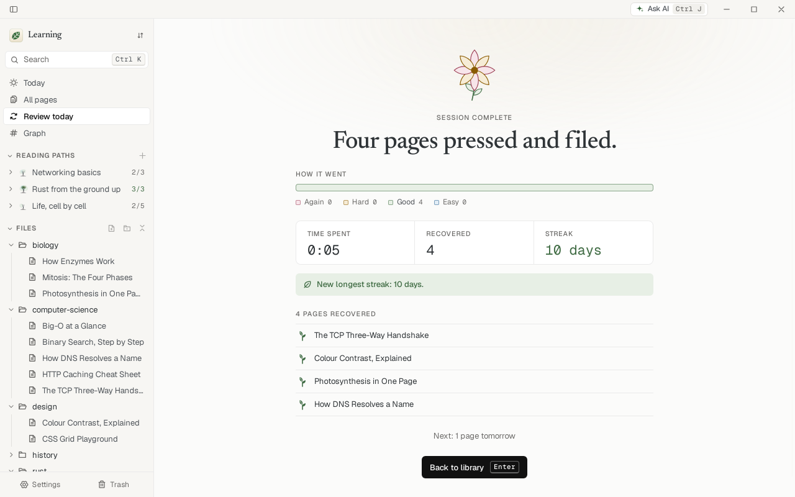
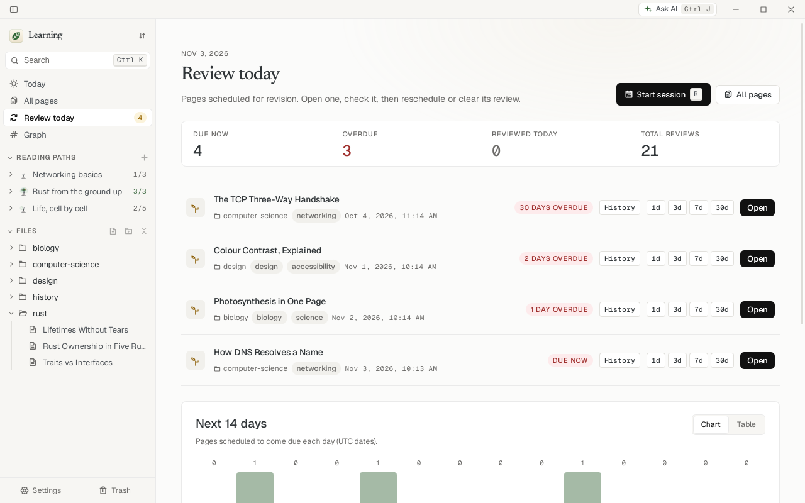
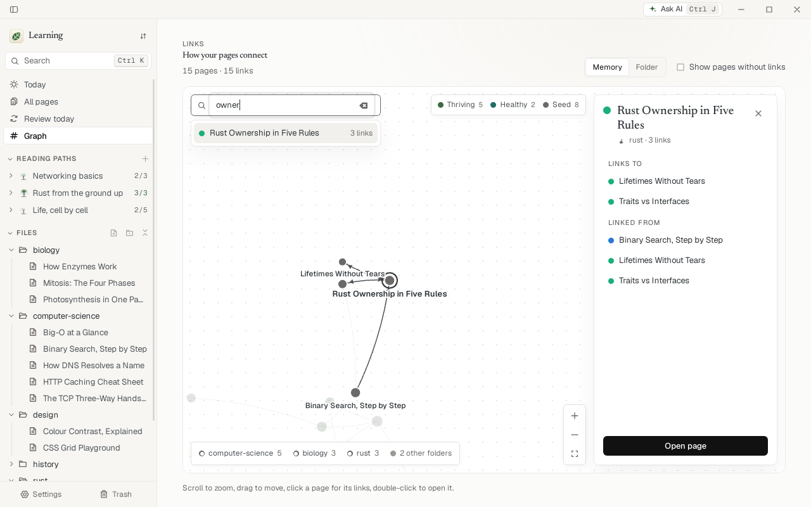
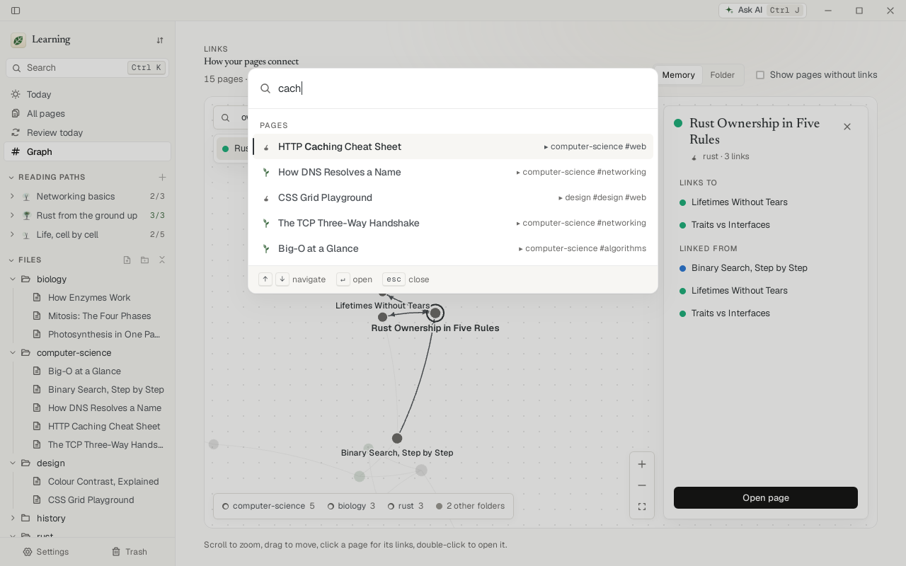
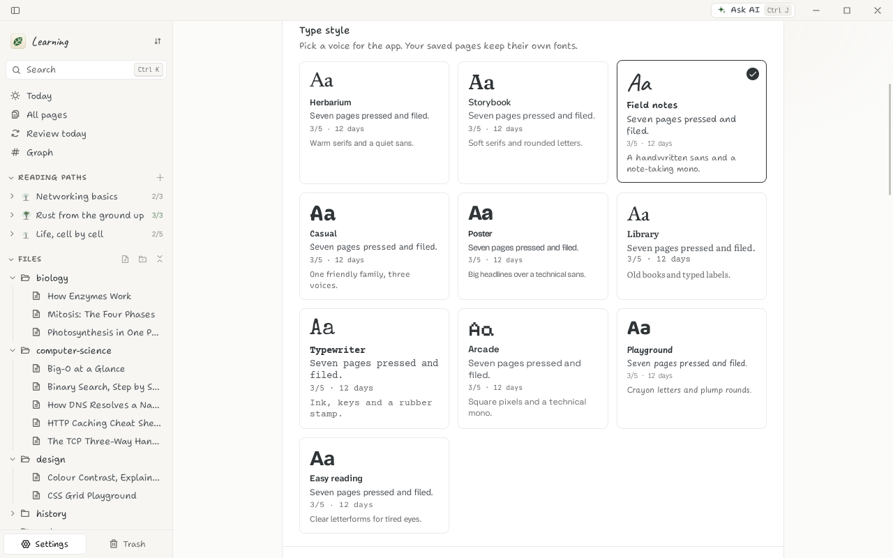

<picture>
  <source media="(prefers-color-scheme: dark)" srcset="docs/brand/icon-dark.svg">
  
</picture>

# Herbarium

[](https://github.com/abdoufermat5/herbarium/actions/workflows/ci.yml)
[](https://github.com/abdoufermat5/herbarium/actions/workflows/release.yml)
[](https://github.com/abdoufermat5/herbarium/releases/latest)
[](https://github.com/abdoufermat5/herbarium/releases)
[](https://snapcraft.io/herbarium)
[](LICENSE)

A quiet home for everything AI explains to you. Save the HTML explainers, cheat sheets and tiny interactive tools that Claude, ChatGPT and Gemini make. Read them offline, annotate them, and let Herbarium bring each one back right before you would forget it.

Your pages stay plain `.html` files in a folder you own.

AI gives you a beautiful explainer for exactly the thing you were trying to understand — then the conversation scrolls away. Herbarium is where those pages live afterwards: a private local library that opens them with their interactivity intact and keeps the ones that matter in your memory.



| Today: due pages, streak and the grove | Library: previews, due dates and vitality | A page, interactive and sandboxed |
| --- | --- | --- |
| <picture><source media="(prefers-color-scheme: dark)" srcset="docs/screenshots/dark-today.png"></picture> | <picture><source media="(prefers-color-scheme: dark)" srcset="docs/screenshots/dark-library.png"></picture> | <picture><source media="(prefers-color-scheme: dark)" srcset="docs/screenshots/dark-reader.png"></picture> |
| **Reading paths grow trees** | **A review session, finished** | **Review, scheduled** |
| <picture><source media="(prefers-color-scheme: dark)" srcset="docs/screenshots/dark-path.png"></picture> | <picture><source media="(prefers-color-scheme: dark)" srcset="docs/screenshots/dark-session.png"></picture> | <picture><source media="(prefers-color-scheme: dark)" srcset="docs/screenshots/dark-review.png"></picture> |
| **The link graph** | **Command palette** | **Ten type styles** |
| <picture><source media="(prefers-color-scheme: dark)" srcset="docs/screenshots/dark-graph.png"></picture> | <picture><source media="(prefers-color-scheme: dark)" srcset="docs/screenshots/dark-palette.png"></picture> | <picture><source media="(prefers-color-scheme: dark)" srcset="docs/screenshots/dark-appearance.png"></picture> |

## Why Herbarium

- **Local by default.** A vault is an ordinary folder of `.html` files and small `.json` sidecars. Back it up, sync it, edit it with any tool; nothing is locked in a cloud account.
- **Interactive, not flattened.** Saved pages run their scripts in a sandbox, so a quiz still quizzes and a playground still responds. Their saved state comes back too.
- **Remembered, not just stored.** Notes, highlights, reading paths and adaptive review turn a pile of one-off explanations into something you actually retain.

## Install

Linux (x86_64 and arm64):

```bash
curl -fsSL https://raw.githubusercontent.com/abdoufermat5/herbarium/main/install.sh | sh
```

Installs the `.deb` on Debian/Ubuntu (asks for `sudo`), the AppImage elsewhere. Pipe to `sh -s -- --appimage` instead to skip `sudo`, or `sh -s -- --uninstall` to remove it.

Or from the [Snap Store](https://snapcraft.io/herbarium) (x86_64): `sudo snap install herbarium`. The snap updates itself and can only open vaults in your home folder or on removable media.

macOS and Windows: download from the [releases page](https://github.com/abdoufermat5/herbarium/releases/latest). These builds are not code-signed yet, so on first launch allow it in System Settings → Privacy & Security (macOS) or choose "More info → Run anyway" (Windows).

## Five minutes in

1. **Add the sample pages** from Today (or Settings → Vault) and open *Welcome to Herbarium*.
2. **Press `R`** to review what is due. Grade with `1`–`4`; each button shows when it will bring the page back.
3. **Press `P`** (or "Plant a path") to put a few pages in reading order, then watch the tree grow as you read them.
4. **Press `Ctrl/⌘ J`** to remix the page you are reading, or to let AI sort the library for you.
5. **Press `?`** for every shortcut, and try the type styles in Settings → Appearance.

## Features

**Bring pages in**

- **Import** by drag and drop, file picker, paste, or `herbarium add <file|-|url>` from a terminal. Bring in every HTML, SVG, **Mermaid and Markdown artifact** from a **Claude or ChatGPT data export** with `herbarium import <export>`, and keep the conversation, tool and prompt as the page's source.
- **Save from the browser**: the extension finds the artifacts in a Claude, ChatGPT or Gemini conversation and saves them in one click, saves any page or selection with its images and styles inlined, shows when a page is already saved, and searches your vault from the address bar (`h` + space). Load it from Settings → Browser.
- **Quick capture**: a global shortcut saves the clipboard as a page, and new HTML files in Downloads are offered for saving.
- **Start with a tour**: add three sample pages as a "Getting started" reading path — an interactive welcome, the forgetting curve and a playground that remembers.

**Read them well**

- **Read** each page in a sandboxed viewer, scripts included. Pages that save progress with `localStorage` or `window.storage` keep it between visits.
- **Highlight** passages and write notes in the margin; they are searchable and come back during review.
- **Quiz** yourself: answers a page marks with `data-herbarium-recall` stay hidden until you reveal them, in a review session or with "Quiz me".
- **Look closer** with the page's contents, zoom from 50 to 200%, and a focus mode that hides everything else.
- **Edit** the HTML in the app or in your own editor. Every in-app or agent edit keeps the previous version, with a side-by-side diff to compare and restore.
- **Offline diagrams, math and code highlighting**: draw diagrams, typeset math, highlight syntax and plot charts with network access turned off. Herbarium bundles Mermaid 11, KaTeX 0.16, highlight.js 11 and Chart.js 4, served locally by the app under `_herbarium/lib/` (Mermaid, KaTeX and highlight.js also as ES modules).
- **Optional diagram server**: point Herbarium at a Kroki server in Settings → Vault to render PlantUML, D2, Graphviz and more. Rendered SVGs are cached in your vault so diagrams stay viewable offline.
- **Save copies** of what a page loads: download remote scripts, styles, fonts and module graphs into your vault in one click, rewriting the page so it works completely offline and with network access turned off.
- **Check** why a page might not work — missing local assets, remote resources, unconfigured diagram server, hosts outside the CDN allowlist, broken links, very large or untitled pages — and make it self-contained or save offline copies in one click.
- **Link** pages with `herbarium-app://open/<id>`, see backlinks in the details panel, and open linked pages without leaving the app.

**Remember them**

- **Today** is a dashboard: a review ring for the day, the last four weeks of reviews, how your garden is doing, the grove of reading paths, what to continue, a page to rediscover and what you saved on this day.
- **Review** with adaptive scheduling (FSRS), choosing the retention you want. Each session shows a progress bar and a timer, and every grade button tells you the interval it would schedule. Finish with a summary of the grades, time spent, pages recovered, your streak and what is due next.
- **See vitality** at a glance: a leaf on cards, list rows, the reader and the palette says whether a page is thriving, healthy, thirsty or wilting — or a seed if it was never reviewed. The graph can colour pages by it.
- **Build a streak** and watch a year of reviews fill in. Skip folders or tags from the queue while keeping their schedule.
- **Grow reading paths**: order pages like a course and step through them with previous/next. Each path grows a tree — a limb and its leaves for every page read, blossoms when every page is done — as an inked SVG or a flat-shaded 3D hero where WebGL is available. The grove on Today shows every path on one ground line.

**Find them**

- **Search** titles, tags, notes, source prompts and page text, with filters such as `tag:rust is:due updated:7d` and negation with `-`. Save a search to keep it in the sidebar.
- **Command palette** (`Ctrl/⌘ K`) for pages, views and actions; press `?` for every shortcut, from `R` to start a review to `P` to plant a path.
- **Graph** your library as an interactive map: folders settle into named islands, links light up a page's neighbourhood, previews and icons help you recognise pages, and it stays smooth with thousands of pages.

**Make them yours**

- **Ask AI** (`Ctrl/⌘ J`), one panel for everything AI: simplify the page you are reading, explain it deeper, add quiz questions, translate it, turn it into a cheat sheet, fix and modernise it, or say what you want. Compare the result with the page and accept it, with your highlights and notes sent along. It can also sort your library into folders and tags for you to approve. Works with Claude (API key or Claude Code), OpenAI, Gemini, DeepSeek, Mistral, OpenRouter, a local Ollama or any OpenAI-compatible service; `herbarium remix` does the same from the terminal.
- **Ten type styles** — Herbarium, Storybook, Field notes, Casual, Poster, Library, Typewriter, Arcade, Playground and an easy-reading face — with four text sizes, previewed live and applied before the first paint. Light and dark themes, English and French.
- **Quiet motion** throughout: views rise into place, the sidebar's selection slides, menus open from where they were triggered, notifications stack and swipe away. Celebrations are kept for finished sessions and fully grown paths, nothing animates while idle, and reduced motion turns it all off.
- **Organize** with folders, tags, emoji icons and colours for pages, folders and tags; move or edit many pages at once. Pages can also be previewed in the grid as a miniature of their first screen.

**Share and keep**

- **Share** a page as a secret gist or on your own GitHub Pages site, update it in place or take it down, or copy a share card to paste anywhere (`herbarium publish`).
- **Export** a page as one self-contained HTML file, or publish the vault or a folder as a static website.
- **Trash** with restore and undo.
- **Your vault stays local.** Pages leave it only when you publish them or ask an AI service to work on them. See [Safety](#safety).

## Your vault

A vault is an ordinary folder. Each page is an `.html` file with a `.json` file next to it for its title, tags, note, highlights, review dates and saved page state. Folders are real directories; earlier versions of edited pages are kept in `.herbarium/history/`. Back it up, sync it or edit it with any tool; Herbarium picks up changes when you come back to the window.

## Safety

Generated HTML runs code, so every page is treated as untrusted. It runs in a sandbox that cannot reach your files, the app or other pages, and it cannot navigate away; links open in your browser only after you confirm.

Pages saved from the browser start with network access off, with their images and styles inlined. API keys and the GitHub token stay in a file only you can read and are sent only to the service they belong to; nothing is published without your confirmation.

Network access is a per-page switch. When on, a page can load scripts and fonts from well-known CDNs and images from any website, which means it can tell its author when you open it. Keep it off for pages you don't trust.

When using an optional diagram server (Settings → Vault), only the diagram's source text is sent, and only to the Kroki server URL you explicitly configured.

## Use with AI agents

Herbarium is also an [MCP](https://modelcontextprotocol.io) server, so agents can save, search, organize and schedule pages, read their highlights, links and health, group them into reading paths, run a review session and learn what is due today. In Claude Code:

```bash
claude mcp add herbarium -- herbarium mcp
```

Then ask, for example, *"write a short HTML explainer of Cargo workspaces and save it to Herbarium under `rust`"*. It uses the vault last opened in the app (or `--vault <path>`).

Pages are also MCP resources (`herbarium://page/<id>`), and the server offers `save_page`, `ask_vault` and `review_session` prompts. To approve agent rewrites before they land, turn on Settings → Agents → Review agent edits.

Pages open from links like `herbarium-app://open/<page-id>`, which `herbarium add` prints and agents can hand you.

## Development

Needs [Node.js](https://nodejs.org), [pnpm](https://pnpm.io), [Rust](https://rustup.rs) and the [Tauri prerequisites](https://tauri.app/start/prerequisites/).

```bash
pnpm install
pnpm tauri dev    # run the app
pnpm preview:web  # the interface in a browser, on a throwaway demo vault (PORT=1530)
make ci           # everything CI checks
pnpm test:e2e     # end-to-end suites (see e2e/)
```

`pnpm preview:web` runs the real interface in any browser, backed by the vault core through `herbarium mcp` (built on first use) on a freshly seeded copy of the demo vault. Desktop-only features (AI, publishing, browser capture, file dialogs) do nothing there. Add `?onboarding` to the address to start without a vault.

The end-to-end suites run the `herbarium` binary, the browser extension in Playwright's Chromium, and the desktop app through [tauri-driver](https://v2.tauri.app/develop/tests/webdriver/) on a virtual display. The desktop suite needs Linux with `webkit2gtk-driver`, `xvfb` and `cargo install tauri-driver`, and is skipped without them. `E2E_SCREENSHOTS=<folder>` keeps screenshots of the key moments.

The logo lives in [`docs/brand/`](docs/brand) as SVG, in a light and a dark version. `pnpm icons` renders every app, tray and extension icon from it; `make screenshots` retakes `docs/screenshots/` and `make demo` records `docs/demo.gif` (both need the desktop suite's Xvfb, tauri-driver and WebKitWebDriver; the demo also needs xdotool and ffmpeg).

Built with Tauri 2, Rust, SQLite and Svelte 5.

### Releasing

Write the changes under `[Unreleased]` in `CHANGELOG.md`, then:

```bash
pnpm release patch   # or minor | major | x.y.z
git push --follow-tags
```

The tag builds every platform and publishes the release. In-app updates need the signing key pair on the repository: the `HERBARIUM_UPDATER_PUBLIC_KEY` variable and the `TAURI_SIGNING_PRIVATE_KEY` secret (create them with `pnpm tauri signer generate`).

Optional channels — Windows code signing, WinGet, Snap and Flatpak — and the repository secrets that turn them on are documented in [`docs/distribution.md`](docs/distribution.md).

## License

[MIT](LICENSE)
